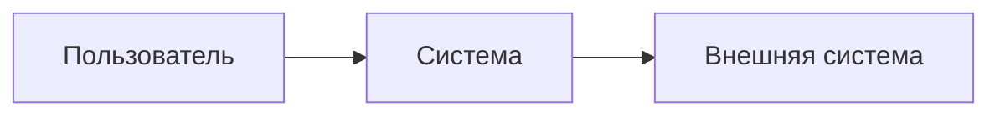
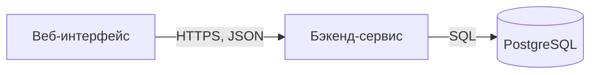

# Архитектура

Документ описывает устройство системы: схемы, слои и правила зависимостей, инварианты и правило переносимости. Схемы оформляются в Mermaid; у каждой схемы есть подпись и легенда. Схемы обновляются в том же PR, что и код.

## Схема контекста

Рис. 1. Контекст системы (заготовка). Легенда: прямоугольник — участник или система, стрелка — направление обращения.

## Схема контейнеров

Рис. 2. Контейнеры системы (заготовка). Легенда: прямоугольник — сервис или приложение, цилиндр — база данных, подпись стрелки — протокол.

## Компоненты

Для сложных сервисов — схема модулей внутри сервиса и их связей.

## Последовательности

Для каждой интеграции и ключевого сценария — схема последовательности, включая ошибки и повторы.

## Состояния

Для сущностей со статусами — схема состояний и допустимых переходов.

## Слои и зависимости

Образец для бэкенд-сервиса; уточняется на стадии архитектуры.

| Слой | Содержит | Может зависеть от |
|---|---|---|
| Предметный | Сущности и правила предметной области | — |
| Прикладной | Сценарии работы системы | Предметный |
| Транспортный | API, обработчики запросов | Прикладной |
| Хранение | Работа с базой данных и внешними хранилищами | Предметный |

Зависимость против направления таблицы не допускается.

## Инварианты

Правила, которые выполняются всегда, независимо от сценария. Каждый инвариант проверяется тестом.

- Образец: сумма заказа равна сумме его позиций.

## Пороги производительности

Для проектов с интерфейсом — пороги Lighthouse CI и размера сборки.

## Переносимость

- У каждого сервиса есть `Dockerfile`; вся система запускается `docker compose up` из `deploy/`.
- Настройки — только переменные окружения.
- Код, привязанный к платформе, запрещён, кроме тонкого адаптера с записью Р-NN.
- Миграции БД применяются самим сервисом либо отдельной командой из `docker-compose.yml`.
