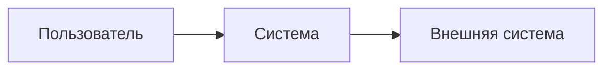

# Общее описание системы

Документ для владельца и руководства: что делает система, для кого и в каких границах. Сначала заполняется брифом предпроекта (`std-discover`), затем уточняется по согласованному `SPEC.md` и обновляется вместе с ним.

## Назначение

Какую задачу бизнеса решает система и какой результат даёт.

## Пользователи и роли

| Роль | Кто это | Что делает в системе |
|---|---|---|

## Функции

Перечень функций системы со ссылками на требования ТР-NN в `SPEC.md`.

## Ключевые сценарии

Основные сценарии работы пользователей: цель, шаги, результат.

## Границы и ограничения

Что система не делает; ограничения по данным, нагрузке, платформам и внешним сервисам.

## Риски и допущения

Персональные данные, платежи, права доступа, зависимость от сторонних сервисов; допущения, принятые без ответа владельца.

## Открытые вопросы

Вопросы владельца (В-NN) со ссылками на issue и принятые умолчания.

## Схема контекста

Рис. 1. Контекст системы (заготовка). Легенда: прямоугольник — участник или система, стрелка — направление обращения.

## Бизнес-процессы

Рис. 2. Бизнес-процесс (заготовка). Легенда: овал — начало или результат процесса, прямоугольник — действие.
